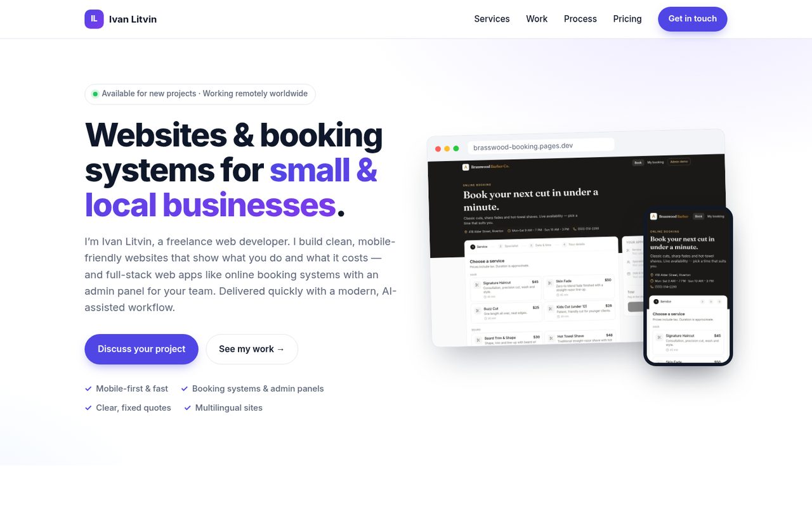
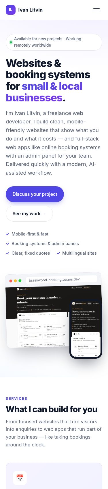

# Ivan Litvin — Freelance Web Developer Portfolio

My personal portfolio site: websites and booking systems for small and local businesses.
It is a hand-coded static site (HTML, CSS and a few lines of JavaScript) with no build step and no framework.

**Live site:** https://ivan-portfolio-aii.pages.dev



## What's inside

- Hero, services, selected work, process and contact sections
- Case studies of my demo projects (screenshots in `assets/`), linking to their live demos:
  - [Brasswood Barber Co. booking system](https://brasswood-booking.pages.dev) — booking flow and admin panel ([code](https://github.com/viperrrrrrrrrrrrrrrr/brasswood-booking))
  - [AutoCare car service website](https://autocare-demo-9b2.pages.dev)
  - [Petalune Nail Studio Telegram Mini App](https://tg-booking-miniapp.pages.dev) — booking inside Telegram ([code](https://github.com/viperrrrrrrrrrrrrrrr/telegram-booking-miniapp))
  - [Vespryn V-40 Meridian 3D watch configurator](https://watch-configurator-demo.pages.dev) ([code](https://github.com/viperrrrrrrrrrrrrrrr/watch-configurator-3d))
  - [Mintleaf Home Cleaning instant quote calculator](https://quote-calculator-demo.pages.dev) ([code](https://github.com/viperrrrrrrrrrrrrrrr/quote-calculator-demo))
  - [Ember & Oat Café editable website (Astro + TinaCMS)](https://editable-site-demo.pages.dev) ([code](https://github.com/viperrrrrrrrrrrrrrrr/editable-site-demo))
- Mobile-first, responsive layout with an accessible mobile menu (`main.js`)
- Optimised WebP images, no tracking scripts

The businesses shown in the case studies are fictional demo clients, and their prices are sample prices.



## Tech stack

- Semantic HTML5
- Plain CSS (`styles.css`, custom properties, CSS grid/flexbox)
- Vanilla JavaScript (`main.js`: mobile menu toggle and current year)
- Inter font from Google Fonts

## Project structure

```
index.html    the whole page
styles.css    styles
main.js       mobile menu + footer year
assets/       project screenshots (WebP) and Open Graph image
```

## Run locally

No install needed. Open `index.html` in a browser, or serve the folder:

```bash
npx serve .          # or: python3 -m http.server 8080
```

## Deploy to Cloudflare Pages

From the repository root:

```bash
npx wrangler pages deploy . --project-name ivan-portfolio
```

You can also connect the GitHub repo in the Cloudflare Pages dashboard with **no build command** and
output directory `/`.

## License

[MIT](LICENSE) © 2026 Ivan Litvin. The case-study screenshots show my own demo projects.
